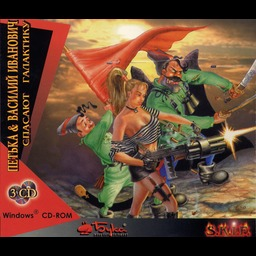

<div align="center" style="width: 30rem">

</div>

# Петька и Василий Иванович спасают галактику

## open-ptk

[English](README.en.md)

Новый движок для игры «Петька и Василий Иванович спасают галактику»
(СКИФ/Бука, 1998), написанный на C по оригинальному `Petka.exe`, разобранному
в IDA Pro. Он запускает игру из её собственных файлов — хранилищ `.STR`,
роликов, сценария — на macOS, Linux, Windows и Nintendo Switch. Файлов игры
здесь нет: они берутся с ваших собственных дисков.

## Что внутри

| папка            | что                                                                                                                                                                                               |
|------------------|---------------------------------------------------------------------------------------------------------------------------------------------------------------------------------------------------|
| `core/`          | `petka_core`, движок без платформы: хранилища `.STR`, BMP, клипы FLIC, маски, диалоги, граф комнат, машина сценария, сетки ходьбы и поиск пути, `.ini` и сохранения. Чистый C11, без зависимостей |
| `launcher/`      | `petka_launcher`, сама игра на [raylib](https://www.raylib.com): сцены, герои, звезда действий, чемодан, карта, панель, разговоры, ролики, звук, сохранение и загрузка                            |
| `switch/`        | сборка под Nintendo Switch: `petka.nro` и устанавливаемое приложение (NSP), см. [switch/README.ru.md](switch/README.ru.md)                                                                        |
| `tools/unpack/`  | `ptk-unpack`, делает папку игры из образов дисков (`.isz`/`.iso`), см. [tools/unpack/README.ru.md](tools/unpack/README.ru.md)                                                                     |
| `tools/strtool/` | показывает и извлекает содержимое хранилища `.STR`                                                                                                                                                |
| `tools/*test/`   | проверки ядра на настоящих файлах: клипы, диалоги, комнаты, сценарий, ходьба                                                                                                                      |
| `tools/play/`    | прохождения частей игры по сценарию (`PETKA_PLAY`)                                                                                                                                                |
| `docs/`          | формат `.STR`, [str-format.ru.md](docs/str-format.ru.md)                                                                                                                                          |

Сверх оригинальной игры у лаунчера есть меню «Дополнительно» (Tab на
компьютере, минус на Switch), где каждое из дополнений включается и
выключается: вид ЭЛТ-монитора, тёмная подложка под текстом, подсветка
предметов, с которыми можно что-то сделать, реплики, которые оригинал не
произносит, а переиздание Reloaded вернуло (восстановленные диалоги), и на
контроллере — притяжение указателя к мелким предметам. Ошибки самого
сценария игры исправляются при загрузке (`launcher/src/scriptfix.c`).

## Файлы игры

```
cd tools/unpack && go build -o ptk-unpack .
./ptk-unpack game ~/ptk1-files "…CD 1.isz" "…CD 2.isz" "…CD 3.isz"
```

даёт папку с хранилищами `.STR`, `intro.avi`, `disk1.id`..`disk3.id` и
`data1_out/`. Больше лаунчеру ничего не нужно.

## Вторая игра

Тот же лаунчер запускает и «Петьку и Василия Ивановича 2: Судный день»
(СКИФ/Бука, 1999): движок и форматы у неё те же. Какая игра в папке,
лаунчер понимает сам, по файлам (`PART_1\objects.ids` в `main.str`), и для
второй не применяет то, что относится к первой: исправления сценария,
восстановленные диалоги, рекламный ролик.

```
./ptk-unpack game ~/ptk2-files ptk2.isz
build/launcher/petka_launcher ~/ptk2-files            # с начала
build/launcher/petka_launcher ~/ptk2-files PART_2     # сразу во вторую часть
```

Её ролики сжаты Indeo 5, это обычный `ffmpeg` тоже умеет. Как поставить её
на Switch — в [switch/README.ru.md](switch/README.ru.md#вторая-игра).

## Сборка на компьютере

Нужны CMake 3.16+, компилятор C11, raylib (ищется через pkg-config) и, для
роликов, программа `ffmpeg` во время работы.

```
brew install cmake raylib pkg-config ffmpeg      # macOS; на других системах те же пакеты
cmake -B build -DCMAKE_BUILD_TYPE=Release
cmake --build build
```

`-DPETKA_STATIC_RAYLIB=ON` встраивает raylib в программу, чтобы один файл
работал на машине без установленного raylib, — так собирается релиз.
Сборка `Debug` добавляет отладочный экран (F1); в `Release` и в
`RelWithDebInfo` по умолчанию его нет.

## Запуск

```
build/launcher/petka_launcher ~/ptk1-files            # с начала
build/launcher/petka_launcher ~/ptk1-files PART_2     # сразу во вторую часть
```

Без аргументов игра ищется там, где лежит программа: скопируйте
`petka_launcher` в папку игры и запускайте оттуда. Сохранения, `Petka.ini` и
`extras.ini` хранятся в той же папке. `ffmpeg` ищется сначала рядом с
программой, потом в `PATH`.

## Управление

| клавиша | что |
|---|---|
| левый щелчок | действие над предметом под курсором или идти туда |
| правый щелчок | звезда действий |
| 1–6 или L W G U T C | смотреть, идти, взять, применить, говорить, Чапаев |
| щелчок, пробел | следующая фраза разговора |
| щелчок по строке, её номер | сказать эту реплику |
| F2 / F3 | сохранить / загрузить |
| Esc | закрыть чемодан, выйти из открытого экрана |
| Alt+R | вернуть курсор и звезду, если игра осталась без них |
| Tab | меню «Дополнительно» |
| F4 | включить и выключить вид ЭЛТ |
| F1 | отладочный экран (только в сборке `Debug`) |

Управление на Switch — в [switch/README.ru.md](switch/README.ru.md#управление).

## Для разработки

Лаунчер умеет играть сам, без человека, через переменные окружения (все они
описаны в начале `launcher/src/main.c`): `PETKA_PLAY=<файл>` проходит шаги
прохождения из `tools/play/`, `PETKA_SHOT=<файл.png>` сохраняет снимок экрана
и выходит, `PETKA_TRACE=1` пишет сообщения сценария в журнал, `PETKA_FAST=1`
и `PETKA_TURBO=1` ускоряют игру.

```
PETKA_PLAY=tools/play/part1.play PETKA_TURBO=1 build/launcher/petka_launcher ~/ptk1-files
```

Инструменты из `tools/*test/` принимают хранилище и часть:

```
build/tools/scripttest/scripttest ~/ptk1-files/MAIN.STR PART_1
build/tools/walktest/walktest ~/ptk1-files/FLC1.STR
```

## Оригинал

Игра и её файлы принадлежат их правообладателям (СКИФ, Бука). В этом
репозитории их нет — только движок; чтобы играть, нужна своя копия игры.
